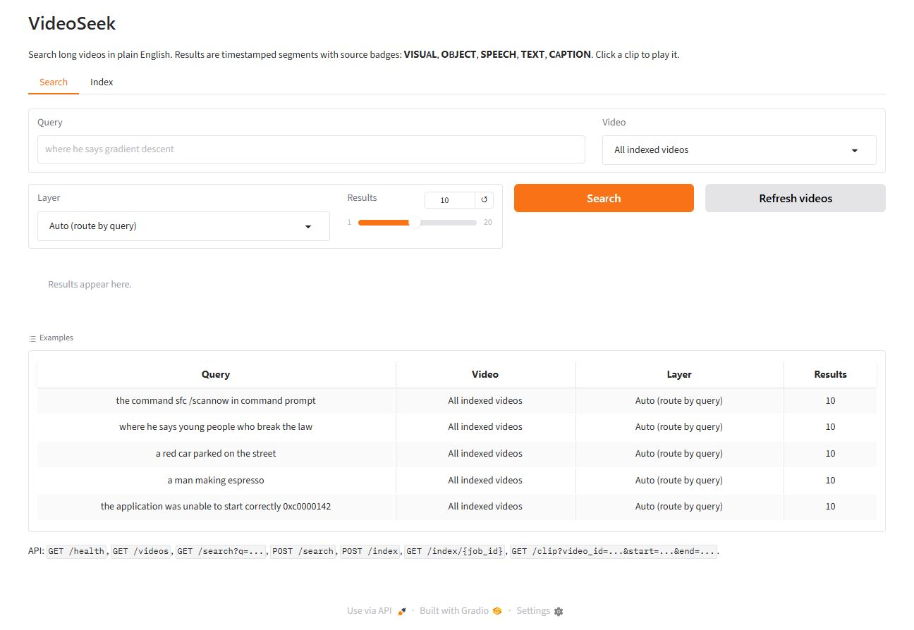

# VideoSeek

Search long videos with plain English. Ask a question, get a timestamp, a thumbnail, and a playable clip.

> **Status: P8 complete — UI, API, and release.** Run `python app.py` and open `http://127.0.0.1:7860`. All five retrieval layers are implemented and searchable with source badges, thumbnails, and playable clips. A+B+D remains the strongest configuration: Recall@5 **0.960** dev / **0.700** held-out, vs **0.860 / 0.600** for frames alone. On a **50-video, 399-query Charades-STA test subset**, Layer A scores **R@1 IoU 0.5 = 0.421**, IoU 0.7 = 0.241, mIoU = 0.377. The optional Qwen2.5-VL top-3 reranker costs **1.40 s p50 / 2.25 s p95** per query. A 27 s demo montage is generated by `scripts/make_demo.py`.



---

## What it does

Index a video once, then search it across five layers:

| Layer | What it indexes | Example query | Status |
|---|---|---|---|
| Frames | scene and place | "empty road at night" | ✅ |
| Objects | people, cars, bags | "person in a red jacket" | ✅ |
| Speech | what is said | "where he says gradient descent" | ✅ |
| On-screen text | slides, signs, labels | "the slide about transformers" | ✅ (P6) |
| Captions | actions and context | "someone arguing" | ✅ (P7) |

Results are returned as time segments with a source badge, so you can see **why** each hit matched.

## Requirements

- **Python 3.10+**
- **FFmpeg** on `PATH` (required for audio and video decoding)
- **GPU recommended** (tested target: NVIDIA RTX 3060 12 GB). CPU works but indexing is much slower.
- **Disk:** model weights several GB on first run; roughly 50–400 MB per hour of indexed video depending on thumbnail settings.
- **RAM:** 8 GB minimum; 16 GB recommended.

## Install

```bash
git clone https://github.com/Fuad-Rafi/Natural-language-video-search-engine.git
cd Natural-language-video-search-engine

python -m venv .venv
# Windows
.venv\Scripts\activate
# Linux / macOS
source .venv/bin/activate

pip install -r requirements.txt
```

Exact versions from the verified Windows + CUDA 13 environment are pinned in `requirements-lock.txt`.

Verify FFmpeg:

```bash
ffmpeg -version
```

## Usage

### Index a video (available)

```bash
# 1. Put a video in data/videos/ (or pass any path)
python scripts/index_video.py --video data/videos/sample.mp4

# 2. Verify frames and timestamps against the source
python scripts/verify_frames.py --video data/videos/sample.mp4
```

Frames are written to `data/frames/<video_id>/` (`000000.jpg`, `metadata.json`, `frames.jsonl`), with a per-run log in `logs/`.

### Search (available)

```bash
# 3. Build the Layer A index (SigLIP + FAISS; downloads ~400 MB on first run)
python scripts/index_frames.py --video data/videos/sample.mp4

# 4. Search it
python scripts/search.py --query "a close-up of a human eye" --video sample

# 5. Build the object layer and search crops
python scripts/index_objects.py --video data/videos/streetcctv1.mp4
python scripts/search.py --query "a red car parked on the street" --layer objects --video dashcam

# 6. Build the speech layer and search the transcript
python scripts/index_speech.py --video data/videos/lecture1.mp4
python scripts/search.py --query "where he says gradient descent" --layer speech --video lecture1

# 7. Build the OCR layer and search on-screen text
python scripts/index_ocr.py --video data/videos/screen_recording.mp4
python scripts/search.py --query "the command sfc /scannow in command prompt" --layer ocr --video screen-recording

# 8. Build captions and search actions/context
python scripts/index_captions.py --video data/videos/indoor1.mp4
python scripts/search.py --query "a man making espresso" --layer caption --video indoor1

# 9. Public Charades-STA test subset
python scripts/prepare_charades_sta.py --download --max-videos 50
python scripts/index_public.py
python scripts/evaluate_public.py --window-s 7.5
```

Search returns frame, object, transcript, OCR, or caption hits; the evaluator merges them into segments. Omitting `--video` searches every indexed video. The first run loads SigLIP (about 2 seconds on the RTX 3060), Whisper/BGE for speech, PaddleOCR/BGE for OCR, and BLIP/BGE for captions.

### Evaluate (available)

```bash
python scripts/evaluate.py --mode A    # frames
python scripts/evaluate.py --mode B    # objects
python scripts/evaluate.py --mode D    # speech (transcript only)
python scripts/evaluate.py --mode E    # OCR (on-screen text only)
python scripts/evaluate.py --mode C    # captions (action/caption only)
python scripts/evaluate.py --mode AB   # RRF fusion, segments
python scripts/evaluate.py --mode ABD  # frames + objects + speech
python scripts/evaluate.py --mode ABDE # frames + objects + speech + OCR
python scripts/evaluate.py --mode ALL  # all five layers

# Per-layer subsets, and held-out validation
python scripts/evaluate.py --mode D --types speech
python scripts/evaluate.py --mode E --types ocr
python scripts/evaluate.py --mode C --types action,caption,counting
python scripts/evaluate.py --mode D --types speech --queries benchmarks/heldout.csv
python scripts/evaluate.py --mode E --types ocr --queries benchmarks/heldout.csv
python scripts/evaluate.py --mode C --types action,caption --queries benchmarks/heldout.csv
python scripts/evaluate.py --mode ABD --queries benchmarks/heldout.csv
python scripts/evaluate.py --mode ALL --queries benchmarks/heldout.csv

# Optional VLM top-3 reranker latency (Qwen2.5-VL-3B)
python scripts/measure_rerank.py --limit 5 --top-n 3
```

All modes merge hits into segments (gap 3 s, minimum 1 s) and report Recall@1/3/5/10, segment mIoU, R@1 IoU 0.5/0.7, duplicate rate, and latency. Speech queries are routed to Layer D inside A+B+D because frame hits saturate the transcript timeline (C-27). OCR and captions are fused as ablations in A+B+D+E and ALL; neither beats A+B+D, so the headline stays A+B+D.

## Run the app

```bash
# after installing requirements
python app.py
# open http://127.0.0.1:7860
```

The app has two tabs:

- **Search** — query box, video selector, layer selector (`Auto`, `All layers`,
  `Frames`, `Objects`, `Speech`, `On-screen text`, `Captions`), and result cards
  with a thumbnail, time range, source badges, score, matched text, and an
  inline playable clip.
- **Index** — local video path, layer checkboxes, background job, and a stage
  log (`frames → objects → speech → ocr → captions`).

API (same process, documented at `/docs`):

| Endpoint | Purpose |
|---|---|
| `GET /health` | status + indexed video count |
| `GET /videos` | indexed videos and their layers |
| `GET /search?q=...&video_id=...&layers=auto&top_k=10` | search |
| `POST /search` | JSON search (`query`, `video_id`, `layers`, `top_k`) |
| `POST /index` | start a background indexing job |
| `GET /index/{job_id}` | job status, stage, and log |
| `GET /media/{path}` | frame/crop thumbnail |
| `GET /clip?video_id=...&start=...&end=...` | playable MP4 clip |

Example:

```bash
curl "http://127.0.0.1:7860/search?q=where%20he%20says%20gradient%20descent&layers=auto"
curl -X POST http://127.0.0.1:7860/index \
  -H "Content-Type: application/json" \
  -d "{\"video_path\":\"data/videos/lecture1.mp4\",\"layers\":[\"frames\",\"speech\",\"ocr\",\"captions\"]}"
```

Docker:

```bash
docker build -t videoseek .
docker run -p 7860:7860 -v "$PWD/data:/app/data" videoseek

# GPU reference image
docker build -f Dockerfile.gpu -t videoseek-gpu .
docker run --gpus all -p 7860:7860 -v "$PWD/data:/app/data" videoseek-gpu
```

Demo montage (<60 s):

```bash
python scripts/make_demo.py   # writes docs/demo.mp4
```

Indexing is cached at every stage: re-running the same video reuses existing frames and embeddings.

## Results

Segment policy: every config merges hits with a 3-second gap and a 1-second minimum before scoring, so Recall and mIoU are comparable across all layers and fusions.

| Config | Dev Recall@5 | Held-out Recall@5 | Dev mIoU | Duplicate rate (raw → merged) |
|---|---|---|---|---|
| A — frames | 0.860 (50) | **0.600** (20) | **0.257** | 0.458 → 0.000 |
| B — objects | 0.440 (50) | 0.450 (20) | 0.042 | 0.112 → 0.000 |
| D — speech | **1.000** (9) | **1.000** (4) | **0.310** | 0.000 → 0.000 |
| E — OCR | 0.750 (12) | 0.500 (4) | 0.270 | 0.117 → 0.000 |
| C — captions | 0.714 (7) | 0.500 (2) | 0.157 | 0.000 → 0.000 |
| A+B — RRF | **0.880** (50) | **0.600** (20) | 0.242 | 0.384 → 0.000 |
| A+B+D — routed | **0.960** (50) | **0.700** (20) | 0.280 | 0.328 → 0.000 |
| A+B+D+E | 0.920 (50) | 0.650 (20) | 0.204 | 0.188 → 0.000 |
| A+B+D+E+C | 0.920 (50) | 0.650 (20) | 0.148 | 0.120 → 0.000 |

The 50-query set is the development benchmark used for tuning; the 20-query held-out set is the honest headline (`benchmarks/heldout.lock.json`). Parentheses show query counts: the D, E, and C rows are scored only on their own query types (D: 9 dev / 4 held-out; E: 12 dev / 4 held-out; C: 7 dev / 2 held-out), while the other rows cover the full set.

A+B improves dev by 2 points but ties frames on held-out. Adding speech and routing speech queries to Layer D raises held-out Recall@5 from 0.600 to **0.700** and mIoU from 0.115 to **0.163** — the first held-out gain beyond frames. On dev, speech alone returns the correct moment in the top 3 for **9/9** queries and the top 5 for **9/9**; held-out is **3/4** top-3 and **4/4** top-5.

OCR behaves like Layer B: useful on its own but not additive. Dev OCR Recall@3 is **0.750** and all **6/6** screen/UI queries are top-3; held-out OCR is 1/4 top-3. Repeated slide titles (multiple slides say "essay 2 introduction") and handwritten chalkboards defeat text-only retrieval, while frames use visual context. Fusing OCR into A+B+D lowers the held-out R@5 from 0.700 to 0.650, so **A+B+D remains the headline**. Duplicate results fall to **0.000** after merging in every config, including OCR (raw 0.117 → merged 0.000).

Captions are also non-additive. On the 7 dev action/caption/counting queries, Layer C scores R@5 **0.714** and mIoU 0.157, while frames already score 1.000 / 0.475. Fusing captions into ALL lowers dev mIoU to 0.148 and held-out R@5 to 0.650. Captions are retained for UI snippets and future re-ranking; **A+B+D remains the production configuration**.

## Public benchmark — Charades-STA test subset

The public number uses **50 Charades-STA test videos and 399 queries**, selected from the official test split and downloaded with HTTP range requests (`scripts/prepare_charades_sta.py`). Videos are indexed at 1 fps with Layer A. The top-1 frame becomes a **7.5 s window** centred on the peak; the window is chosen from the Charades-STA **train-split median duration (7.4 s)**, not tuned on test.

| Metric | Layer A |
|---|---|
| R@1 IoU 0.5 | **0.421** |
| R@1 IoU 0.7 | **0.241** |
| mIoU | **0.377** |
| Any overlap | 0.692 |

This is a frame-retrieval baseline, not a trained temporal-grounding model. The project's 1-second segment policy is too narrow for 30-second Charades clips (R@1 IoU 0.5 = 0.008); the fixed-window protocol is reported explicitly in `benchmarks/public/results/`. Reproduce with `scripts/prepare_charades_sta.py`, `scripts/index_public.py`, and `scripts/evaluate_public.py`.

## Optional VLM reranker

`scripts/measure_rerank.py` runs Qwen2.5-VL-3B as a yes/no check on the top 3 candidates. Measured on 5 dev queries (15 images) after warm-up: **p50 1.40 s**, mean 1.67 s, **p95 2.25 s** per query; yes-rate 0.733. It is optional (`captions.rerank_enabled: false`) and not part of the headline metrics.

Full tables, per-type breakdowns, and failure notes: `benchmarks/results/`, `benchmarks/failures/`.

## Configuration

Defaults live in `configs/default.yaml`:

```yaml
video:
  sample_fps: 1.0
  keyframe_fps: 0.5

speech:
  model: small
  chunk_seconds: 30
  overlap_seconds: 5

ocr:
  lang: en
  text_detection_model_name: PP-OCRv5_mobile_det
  text_recognition_model_name: PP-OCRv5_mobile_rec
  keyframe_min_interval_s: 2.0
  keyframe_max_interval_s: 15.0
  scene_threshold: 0.08
  dedupe_similarity: 0.9

captions:
  backend: blip
  model: Salesforce/blip-image-captioning-base
  keyframe_interval_s: 5.0
  max_keyframes: 300
  dedupe_similarity: 0.9

text:
  embedding_model: BAAI/bge-small-en-v1.5
  use_bm25: true
  query_prefix: true

search:
  top_k: 20
  rrf_k: 60
  rrf_window_s: 2.0
  merge_gap_s: 3.0
  min_segment_s: 1.0
  route_speech: true
  route_ocr: false
  route_caption: false
  weights:
    frame: 1.0
    object: 1.0
    speech: 1.2
```

Override per run with `--config path/to/config.yaml`.

## Models

Downloaded automatically on first use:

| Component | Model | Approx. size |
|---|---|---|
| Frame embeddings | SigLIP base patch16-224 | ~400 MB |
| Object detection | YOLO11n | ~6 MB |
| Speech | faster-whisper small | ~500 MB |
| OCR | PaddleOCR PP-OCRv5 mobile (English) | ~20 MB |
| Captions | BLIP-base (Qwen2.5-VL-3B optional reranker) | ~1 GB / ~6 GB |
| Text embeddings | bge-small-en-v1.5 | ~130 MB |

Models are downloaded to the Hugging Face / Ultralytics cache, not into this repository.

## Troubleshooting

| Problem | Fix |
|---|---|
| `ffmpeg not found` | Install FFmpeg and add it to `PATH` |
| CUDA out of memory | Use a smaller model, close other GPU apps, or run on CPU |
| Whisper CUDA DLL error | Install `nvidia-cublas-cu12` / `nvidia-cudnn-cu12` (already in the lock file), or run `--device cpu` |
| PaddleOCR oneDNN crash | `ocr.enable_mkldnn: false` is already the default on Windows; keep it false |
| OCR indexing slow on CPU | Use the mobile models (default), raise `ocr.keyframe_max_interval_s`, or install a GPU Paddle build |
| Caption model OOM | BLIP-base is the default (~1 GB); Qwen 3B needs ~8 GB VRAM and is only used for top-3 reranking |
| No audio stream | The speech layer is skipped; other layers still work |
| No text found | OCR may need higher-resolution keyframes |
| Slow first run | Model download + one-time indexing |

## Data

No videos are included. Use your own footage or a public dataset that permits research use. Dataset files are not redistributed by this repository.

## License

**AGPL-3.0.** This project uses [Ultralytics YOLO11](https://github.com/ultralytics/ultralytics), which is licensed under AGPL-3.0. See `LICENSE`.

If you need a permissive license for commercial use, replace the detector with an Apache-2.0/MIT model (for example RT-DETR via Transformers) or obtain a commercial Ultralytics license.

## Contributing

Issues and suggestions are welcome. Please open an issue before a large pull request.
